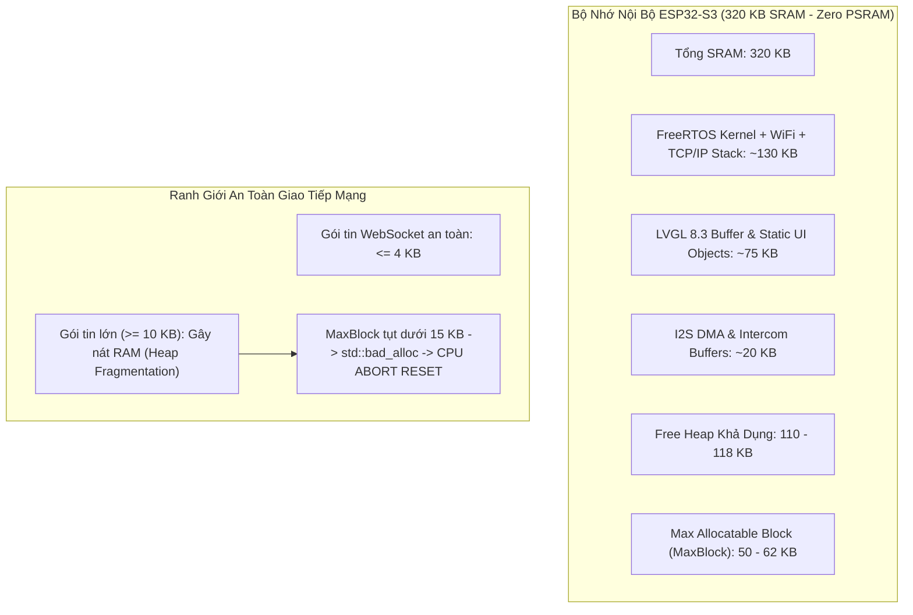
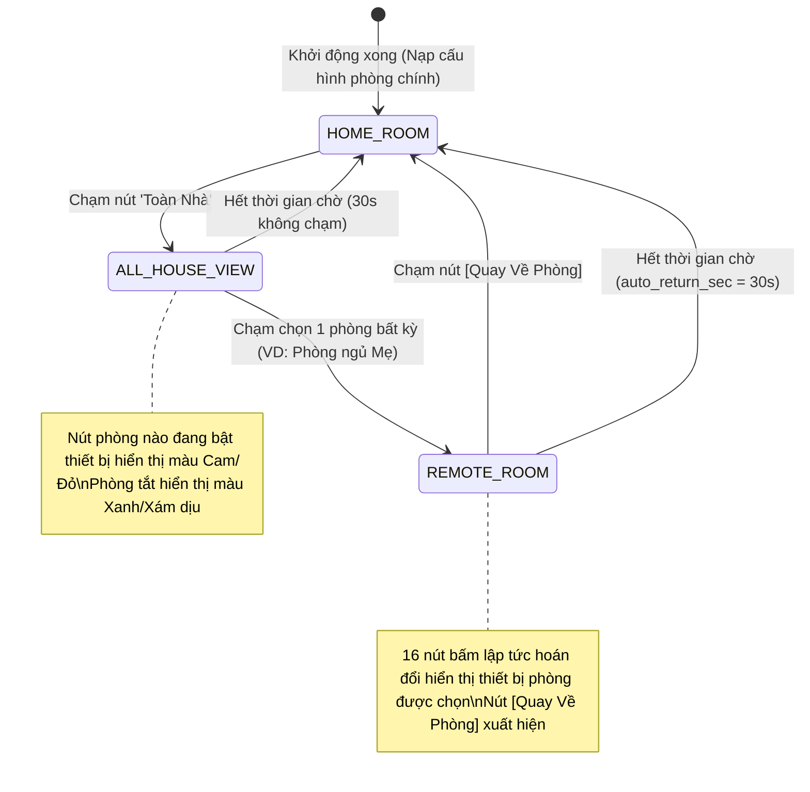

# NALA SMART HOME — BỘ TÀI LIỆU TOÀN DIỆN HỆ THỐNG
## SYSTEM MASTER SPECIFICATION & CROSS-CHECK VERIFICATION (SINGLE SOURCE OF TRUTH v1.1.0)

> **MỤC ĐÍCH TÀI LIỆU**: Đây là bản đặc tả kỹ thuật và tiêu chuẩn nghiệm thu chéo tối thượng của dự án **NALA SMART HOME (Wall Panel & Voice Intercom Hub)**. Toàn bộ các bẫy phần cứng, giới hạn bộ nhớ SRAM (không PSRAM), ràng buộc chân ngoại vi, cơ chế an toàn fail-safe, giao thức mạng và quy trình Rollback cứu hộ đều được chuẩn hóa 100% dựa trên mã nguồn thực tế và phần cứng vật lý. Bất kỳ Kỹ sư nhúng hoặc Trợ lý AI (Gemini Web, Claude, ChatGPT, DeepSeek) khi đọc tài liệu này đều có thể nắm bắt toàn bộ dự án chuẩn xác, không bị bẫy phần cứng gây crash/reset chip, không sai chân GPIO và không sinh ảo giác.

---

## 1. LỜI NHẮC NGỮ CẢNH DÀNH CHO AI (CONTEXT PRIMING PROMPT)

*Đoạn prompt chuẩn hóa dưới đây dùng để người dùng copy và dán trực tiếp vào **Gemini Web** (hoặc Claude/ChatGPT) khi muốn tiếp tục phát triển, hỏi đáp hoặc yêu cầu viết code mới mà không bị lệch pha:*

```text
Bạn đang đóng vai trò Kỹ sư trưởng Hệ thống Nhúng (Lead Embedded Systems Architect) của dự án NALA SMART HOME.
Khi lập trình, phân tích hoặc sửa đổi bất kỳ phần nào của dự án, bạn BẮT BUỘC phải tuân thủ nghiêm ngặt các sự thật phần cứng (Ground Truth) sau:

1. VI ĐIỀU KHIỂN & BỘ NHỚ (HARDWARE CONSTRAINTS):
   - Bo mạch: ESP32-S3 DevKitC-1 N8 (ESP32-S3 Xtensa dual-core LX7 240MHz, 16MB Flash).
   - PSRAM: KHÔNG CÓ PSRAM NGOÀI (PSRAM: 0.00 MB free). Chỉ có 320 KB SRAM nội bộ!
   - Ngưỡng an toàn bộ nhớ: Free Heap phải luôn >= 110 KB; Max Allocatable Block (MaxBlock) phải >= 50 KB.
   - CẤM TUYỆT ĐỐI: Không cấp phát động (dynamic allocation) các widget LVGL khi chuyển phòng. Toàn bộ UI phải sử dụng cơ chế Zero-RAM (tái sử dụng mảng tĩnh 16 nút bấm và chip lọc phòng có sẵn).
   - GIỚI HẠN GÓI TIN MẠNG: Payload WebSocket JSON gửi tới ESP32 KHÔNG ĐƯỢC VƯỢT QUÁ 3-4 KB. Nếu server gửi chuỗi JSON >= 10 KB liên tục, ESP32 sẽ lập tức cạn MaxBlock và kích hoạt abort() std::bad_alloc -> Vòng lặp khởi động lại (Reboot loop).

2. PHẦN CỨNG ÂM THANH & MÀN HÌNH (VERIFIED PINOUT):
   - Codec Âm Thanh: Everest ES8311 (I2C addr 0x18 trên SCL GPIO 15, SDA GPIO 16).
   - I2S Master Clock (MCLK): GPIO 4 (BẮT BUỘC 4.096 MHz = 256 * 16kHz).
   - I2S BCLK: GPIO 5 | I2S LRCK (WS): GPIO 7 | I2S DOUT (Loa): GPIO 8 | I2S DIN (Mic): GPIO 6.
   - Amply Loa SC8002B: Chân PA_EN = GPIO 1 (ACTIVE LOW: LOW = Bật amply ra loa, HIGH = Mute).
   - Màn hình LCD 2.8" SPI (ST7789/ILI9341): MOSI GPIO 11, SCLK GPIO 12, MISO GPIO 13, CS GPIO 10, DC GPIO 46, Backlight PWM GPIO 45.
   - Cảm ứng điện dung: FT6336U/CST328 trên I2C chung, INT GPIO 17, RST GPIO 18.
   - RGB LED: WS2812 trên GPIO 42. Nút BOOT: GPIO 0.

3. HẠ TẦNG SERVER & ĐIỀU KHIỂN:
   - NAS Hub: 192.168.1.114:8765 (FastAPI WebSockets + Python ha_bridge.py nối Home Assistant 192.168.1.27:8123).
   - Sự kiện ha_state_change từ Server tới Panel phải tinh gọn tối đa (~300 - 800 bytes), chỉ chứa entity_id, state, attributes và house_status; KHÔNG gửi toàn bộ cây phòng all_rooms_summary trong sự kiện trạng thái thiết bị.
   - Giao thức đàm thoại Intercom: Binary Frame 520 bytes (0xA55A, sender_id, target_id, seq_num, stream_flag, 512 bytes PCM 16kHz Mono, CRC-8).

4. BẢN PHÁT HÀNH ỔN ĐỊNH HIỆN TẠI:
   - Phiên bản: v3.3.1-stable (Zero-RAM Smart Floor & Room Hub).
   - Bản lưu trữ dự phòng: v3.2.1-stable.
```

---

## 2. ĐẶC TẢ PHẦN CỨNG & BẢNG GOLDEN PINOUT

### 2.1 Bảng Quy Hoạch Chân Golden Pinout (Đã Đo Đạc & Chạy Thực Tế)

| Nhóm Ngoại Vi | Chân Mạch | GPIO ESP32-S3 | Chế Độ Hoạt Động | Ràng Buộc Kỹ Thuật & Xử Lý Phần Cứng |
| :--- | :--- | :--- | :--- | :--- |
| **Strapping / Boot** | BOOT / IO0 | **GPIO 0** | Input Pull-up | [STRAPPING PIN] Phải giữ mức HIGH khi mở nguồn. Nhấn giữ kéo GND vào Bootloader. |
| **Amply SC8002B** | PA_EN | **GPIO 1** | Output Push-pull | **Active LOW**: Mức `0` mở nguồn amply phát loa; Mức `1` tắt nguồn amply chống xì (Mute). |
| **Audio Master Clock**| I2S_MCLK | **GPIO 4** | CLK Output | Xung nhịp $4.096\text{ MHz} = 256 \times 16\text{kHz}$. Thiếu MCLK khiến ES8311 đơ DAC/ADC. |
| **Audio Bit Clock** | I2S_BCLK | **GPIO 5** | Clock Output | Tần số $16\text{kHz} \times 16\text{bit} \times 2 = 512\text{ kHz}$. |
| **Audio Mic Data In** | I2S_DIN | **GPIO 6** | Input Serial | Nhận dữ liệu PCM từ Micro onboard qua ES8311. Cấm kéo chân này làm Output. |
| **Audio Word Select** | I2S_LRCK | **GPIO 7** | WS Output | Chuyển đổi khung âm thanh Trái/Phải (16kHz). |
| **Audio Speaker Out** | I2S_DOUT | **GPIO 8** | Output Serial | Xuất dữ liệu âm thanh tới DAC ES8311 phát ra loa. |
| **LCD Chip Select** | LCD_CS | **GPIO 10** | Output Push-pull | Chọn IC điều khiển LCD (Active LOW). |
| **LCD SPI MOSI** | LCD_MOSI | **GPIO 11** | SPI2 Host Data | Truyền dữ liệu điểm ảnh màn hình ST7789. |
| **LCD SPI SCLK** | LCD_SCLK | **GPIO 12** | SPI2 Host Clock | Xung nhịp SPI màn hình (40MHz / 80MHz). |
| **LCD SPI MISO** | LCD_MISO | **GPIO 13** | SPI2 Host MISO | Đọc dữ liệu định danh màn hình. |
| **I2C Bus SCL** | SCL | **GPIO 15** | Open-drain Pullup | Bus I2C dùng chung cho ES8311 (0x18) và Touch IC (0x38/0x1A). Trở kéo 4.7kΩ. |
| **I2C Bus SDA** | SDA | **GPIO 16** | Open-drain Pullup | Bus I2C dữ liệu chung. Trở kéo 4.7kΩ. |
| **Touch Interrupt** | TP_INT | **GPIO 17** | Input Pullup | Ngắt kích hoạt khi có ngón tay chạm cảm ứng. |
| **Touch Reset** | TP_RST | **GPIO 18** | Output Push-pull | Reset phần cứng IC cảm ứng điện dung (Active LOW). |
| **RGB LED** | LED_RGB | **GPIO 42** | Output Single-wire| Điều khiển LED địa chỉ WS2812 (NeoPixel). |
| **LCD Backlight** | LCD_BL | **GPIO 45** | LEDC PWM Kênh 0 | [STRAPPING PIN] PWM tần số 5000Hz, độ phân giải 8-bit (0-255). |
| **LCD Data/Command** | LCD_DC | **GPIO 46** | Output Push-pull | [STRAPPING PIN] Mức `0` = Command, Mức `1` = Data. |

### 2.2 Sơ Đồ Khối & Ràng Buộc Bộ Nhớ Cực Hạn (Memory Boundaries)



---

## 3. GIAO THỨC TRUYỀN THÔNG, DỮ LIỆU & MÁY TRẠNG THÁI (FSM)

### 3.1 Giao Thức Đàm Thoại Intercom (520 Bytes Binary Frame)

Luồng âm thanh hai chiều giữa các phòng và máy chủ AI truyền trực tiếp qua kênh WebSocket nhị phân:

```text
+-------------------+---------------+-------------------+-----------------------------------------------+----------+
| Bytes 0..1 (2B)   | Byte 2 (1B)   | Byte 3 (1B)       | Bytes 4..5 (2B) | Byte 6 (1B)                 | B7..518  | B519 (1B)|
| Magic Word 0xA55A | sender_room_id| target_room_id    | Sequence Number | Stream Flag (1:START,2:STREAM,3:END) | 512B PCM | CRC-8    |
+-------------------+---------------+-------------------+-----------------------------------------------+----------+
```
- Tốc độ lấy mẫu: $16\text{ kHz}$, 16-bit Mono PCM ($1\text{ mẫu} = 2\text{ bytes}$).
- Kích thước mỗi khung: 512 bytes dữ liệu âm thanh = 256 mẫu = $16\text{ ms}$ thời gian thực.
- Kiểm tra toàn vẹn: Thuật toán CRC-8 với đa thức $0\text{x}07$ trên 519 byte đầu.

### 3.2 Giao Thức WebSocket Điều Khiển (JSON Payloads)

Để bảo vệ chip ESP32 không bị tràn RAM, toàn bộ giao tiếp JSON được phân hóa chặt chẽ:

1. **Gói tin khởi tạo khi kết nối (`config_sync`) — Tần suất: 1 lần lúc khởi động:**
   ```json
   {
     "type": "config_sync",
     "device_id": "panel_bedroom_ty",
     "room_name": "Phòng ngủ Tý",
     "room_id": 1,
     "auto_return_sec": 30,
     "buttons": [
       {"id": "light_main", "name": "Đèn trần", "type": "light", "state": "off"},
       {"id": "switch_fan", "name": "Quạt thông gió", "type": "fan", "state": "on"}
     ],
     "all_rooms": [
       {"id": 1, "name": "Phòng ngủ Tý", "floor": "Tầng 2", "active": 1, "total": 4},
       {"id": 2, "name": "Phòng chiếu", "floor": "Tầng 3", "active": 0, "total": 3}
     ]
   }
   ```
   *Giới hạn payload: $\le 3.5\text{ KB}$ (giới hạn tối đa 8 phòng và 6 nút/phòng).*

2. **Gói tin cập nhật trạng thái thiết bị (`ha_state_change`) — Tần suất: Nhiều lần/giây khi có thiết bị thay đổi:**
   ```json
   {
     "type": "ha_state_change",
     "entity_id": "light.phong_ngu_ty_den_tran",
     "state": "on",
     "is_on": true,
     "attributes": {"brightness": 255},
     "house_status": {"active_lights": 3, "active_ac": 1, "alert": "Đang bật 4 thiết bị"}
   }
   ```
   *Kích thước: Chỉ từ $300\text{ bytes} - 800\text{ bytes}$. Tuyệt đối KHÔNG kèm danh sách `all_rooms`!*

### 3.3 Máy Trạng Thái Zero-RAM Smart Floor & Room Navigation

Toàn bộ logic chuyển phòng của màn hình hoạt động dựa trên cơ chế hoán đổi dữ liệu (Data Swapping) trên cùng một tập 16 widget giao diện có sẵn, đảm bảo Free Heap không suy giảm dù chuyển phòng liên tục:



---

## 4. TIÊU CHÍ KIỂM TRA CHÉO (CROSS-CHECK VERIFICATION CHECKLIST)

Khi lập trình hoặc review code trên repository này, AI và Kỹ sư phải dùng danh sách kiểm tra sau để nghiệm thu:

### Nhóm 1: Kiểm Tra Giới Hạn Bộ Nhớ & SRAM ESP32-S3
- [ ] Không có hàm `lv_obj_create()`, `lv_btn_create()`, `lv_label_create()` mới nào được gọi khi người dùng bấm chuyển phòng hoặc nhận gói tin WebSocket.
- [ ] Free Heap sau khi kết nối WebSocket và vẽ giao diện phải duy trì $\ge 110\text{ KB}$.
- [ ] Khối nhớ lớn nhất có thể cấp phát (`ESP.getMaxAllocHeap()`) phải duy trì $\ge 50\text{ KB}$.
- [ ] `ArduinoJson` sử dụng `JsonDocument` tĩnh hoặc kích thước định sẵn $\le 4096\text{ bytes}$.

### Nhóm 2: Kiểm Tra An Toàn Phần Cứng & Strapping Pins
- [ ] GPIO 0 (BOOT) luôn ở mức PULL-UP trong trạng thái hoạt động bình thường.
- [ ] GPIO 1 (PA_EN) được cấu hình `OUTPUT` và điều khiển mức `LOW` khi cần phát âm thanh, `HIGH` khi nghỉ.
- [ ] GPIO 4 xuất Master Clock liên tục $4.096\text{ MHz}$ qua I2S0 peripheral.
- [ ] GPIO 45 và GPIO 46 (Strapping pins của LCD) được cấu hình sau khi bootloader hoàn tất.

### Nhóm 3: Kiểm Tra Gói Tin & Phân Luồng Server NAS
- [ ] Hàm `on_ha_state_change` trong `main_ws_server.py` gửi payload rút gọn ($< 1\text{ KB}$), không lồng chuỗi `all_rooms`.
- [ ] Thiết bị chưa định danh (`default_panel`) bị loại trừ khỏi danh sách broadcast cập nhật trạng thái Home Assistant để tránh buffer tràn.
- [ ] Hàm `IntercomRouter.unregister()` xử lý đầy đủ tham số `(device_key, websocket=None)`.

### Nhóm 4: Kiểm Tra Cơ Chế Tự Động Quay Về (Auto-Return)
- [ ] Biến đếm `last_remote_touch_ms` được cập nhật mỗi khi có thao tác chạm vào màn hình.
- [ ] Sau khi không có tương tác vượt quá `auto_return_sec` (mặc định 30 giây), màn hình tự động chuyển về phòng chính và phục hồi 16 nút gốc.

### Nhóm 5: Kiểm Tra Âm Thanh Đàm Thoại
- [ ] Gửi lệnh ký tự `'d'` qua Serial COM in ra đúng bảng 69 thanh ghi Everest ES8311.
- [ ] Gửi lệnh ký tự `'t'` qua Serial COM loa phát rõ ràng âm Sine tone 1000Hz mà không rè.
- [ ] Gửi lệnh ký tự `'m'` qua Serial COM mic thu âm đạt RMS > 100 khi có tiếng nói trực diện.

---

## 5. BẢNG MÃ LỖI THƯỜNG GẶP & BIỆN PHÁP KHẮC PHỤC CẤP TỐC

| Triệu Chứng Lỗi | Nguyên Nhân Gốc Rễ | Giải Pháp Khắc Phục Cấp Tốc |
| :--- | :--- | :--- |
| **ESP32 reboot liên tục kèm log: `abort() was called at PC 0x420ca6e3 (operator new)`** | Server NAS gửi chuỗi JSON quá lớn (>13 KB) khiến Free Heap bị vỡ mảnh, MaxBlock < 15 KB | Sửa `main_ws_server.py` loại bỏ cây `all_rooms` khỏi tin nhắn `ha_state_change`. Khởi động lại container `docker restart nala_nas_ws_hub`. |
| **Loa im lặng hoàn toàn dù I2S đang truyền** | Chân PA_EN (GPIO 1) đang ở mức `HIGH` (Mute) hoặc IC ES8311 chưa được cấp xung MCLK trên GPIO 4 | Kiểm tra lệnh `digitalWrite(PINS_PA_EN, LOW);` và xác nhận chân GPIO 4 đo được xung clock $4.096\text{ MHz}$. |
| **Microphone ghi nhận tín hiệu bằng 0 (RMS = 0)** | ES8311 thanh ghi 0x14/0x16 chưa kích hoạt đường MIC1P hoặc chân GPIO 6 bị tranh chấp cấu hình | Nạp lại driver `audio_es8311_engine.h`, thanh ghi `0x14 = 0x1A` (bật Mic Bias) và `0x16 = 0x24` (tăng độ nhạy PGA). |
| **Cảm ứng bị đơ sau khi nạp firmware mới** | IC cảm ứng FT6336U bị treo trạng thái I2C | Thực hiện chu kỳ Reset phần cứng: kéo GPIO 18 xuống `LOW` trong 20ms rồi kéo lên `HIGH`, chờ 100ms trước khi gọi `Wire.begin()`. |
| **Nút bấm chuyển sang phòng khác bị mất nút phòng chính** | Cơ chế sao lưu mảng nút phòng chính bị ghi đè | Xác nhận hàm `backup_home_devices()` được gọi duy nhất 1 lần lúc nhận `config_sync`, tuyệt đối không gọi trong lúc đang ở chế độ xem phòng từ xa. |

---

## 6. HƯỚNG DẪN QUY TRÌNH ROLLBACK CẤP TỐC (EMERGENCY ROLLBACK PROTOCOL)

Khi gặp sự cố nghiêm trọng trên bất kỳ bản dựng thử nghiệm nào trong tương lai, kỹ sư có thể khôi phục hệ thống về trạng thái ổn định chỉ với một trong hai phương án sau:

### Phương Án A: Nạp Đè File Binary Ổn Định Đã Lưu Trữ (Nhanh nhất - 1 Phút)

1. **Khôi phục bản `v3.3.1-stable` (Hỗ trợ Toàn Nhà Zero-RAM):**
   ```powershell
   # Nạp qua cổng USB COM vật lý (ví dụ COM6)
   & "$env:USERPROFILE\.platformio\penv\Scripts\python.exe" "$env:USERPROFILE\.platformio\packages\tool-esptoolpy\esptool.py" --chip esp32s3 --port COM6 --baud 921600 write_flash 0x10000 "nas_firmware_backup\firmware_v3.3.1_stable.bin"
   ```

2. **Khôi phục bản `v3.2.1-stable` (Bản dự phòng kinh điển trước khi có Toàn Nhà):**
   ```powershell
   & "$env:USERPROFILE\.platformio\penv\Scripts\python.exe" "$env:USERPROFILE\.platformio\packages\tool-esptoolpy\esptool.py" --chip esp32s3 --port COM6 --baud 921600 write_flash 0x10000 "nas_firmware_backup\firmware_v3.2.1_stable.bin"
   ```

3. **Cập nhật đồng loạt các Panel trong nhà qua OTA:**
   ```powershell
   # Đẩy binary lên NAS Hub để OTA cho Panel 881C và D6F4
   python server_nas_hub/app/tools/deploy_to_nas.py nas_firmware_backup/firmware_v3.3.1_stable.bin
   ```

### Phương Án B: Rollback Mã Nguồn Git (Mã Nguồn Đầy Đủ)

```powershell
# Chuyển về nhánh release v3.3.1 ổn định
git checkout release-v3.3.1

# Hoặc chuyển về nhánh release v3.2.1 ổn định
git checkout release-v3.2.1

# Biên dịch lại sạch sẽ
& "$env:USERPROFILE\.platformio\penv\Scripts\platformio.exe" run -d firmware_esp32s3_panel -t clean
& "$env:USERPROFILE\.platformio\penv\Scripts\platformio.exe" run -d firmware_esp32s3_panel
```

---
*Tài liệu được khởi tạo và kiểm chứng tự động bởi hệ thống Antigravity Lead Systems Architect v1.1.0.*
