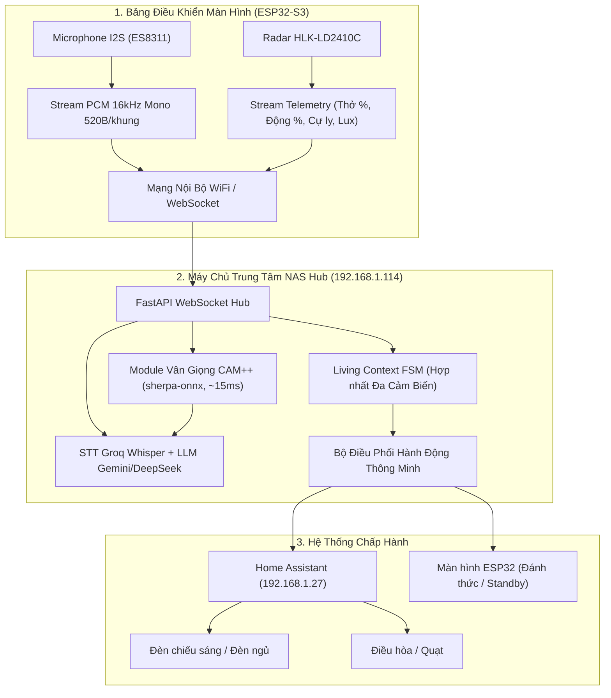

# 🧠 KẾ HOẠCH NÂNG CẤP NALA AI: NHẬN DIỆN VÂN GIỌNG & TỰ ĐỘNG HÓA NGỮ CẢNH
## NALA SMART HOME - INTELLIGENCE EVOLUTION MASTER PLAN (v1.0)

> **Mục tiêu**: Chuyển đổi NALA Smart Home từ hệ thống tự động hóa tuyến tính (bật/tắt theo điều kiện đơn giản) sang **Hệ thống Quản gia AI Nhận thức Ngữ cảnh (Context-Aware Living Agent)**: Nhận biết chính xác ai đang nói bằng dấu vân giọng (Voiceprint) và thấu hiểu trạng thái sinh hoạt thực tế (ngủ say, thức giấc đêm, sinh hoạt, phòng vắng) để điều khiển thông minh tự nhiên.

---

## 1. BẢNG ĐỐI CHIẾU THẨM ĐỊNH PHẦN CỨNG & CÔNG NGHỆ

### Thẩm định tài nguyên thực tế:
| Thành phần | Thông số thực tế | Đánh giá & Ràng buộc kỹ thuật |
| :--- | :--- | :--- |
| **ESP32-S3 Wall Panel** | 0MB PSRAM, 320KB SRAM, 16MB Flash. | **Bảo toàn nguyên tắc Zero PSRAM**: ESP32 chỉ làm nhiệm vụ thu phát âm thanh và hiển thị giao diện. Tuyệt đối không nạp thêm thư viện AI nào lên ESP32. |
| **Radar mmWave HLK-LD2410C** | UART1 @ 256000 bps, Engineering Mode (0x0062). | Đo trực tiếp: Cự ly (cm), Năng lượng thở tĩnh (0-100%), Năng lượng động (0-100%), Cường độ sáng (0-255 lx). |
| **Máy chủ NAS Hub** | Ubuntu Linux x86, Docker Python 3.11, kết nối Gigabit. | Dư thừa năng lực CPU để chạy model CAM++ ONNX (~20MB) và FSM thời gian thực (độ trễ <15ms). |
| **Mô hình Voiceprint (XiaoZhi)** | Alibaba 3D-Speaker (**CAM++**). | Thư viện `sherpa-onnx` hỗ trợ nguyên bản C++/Python, trích xuất 192-dim vector trong 15ms trên CPU. |

---

## 2. MA TRẬN 5 NGỮ CẢNH SỐNG (LIVING CONTEXT SENSOR FUSION)

Hệ thống chấm dứt hoàn toàn việc kích hoạt bật/tắt tuyến tính thông thường bằng máy trạng thái 5 ngữ cảnh thời gian thực:

| Ngữ Cảnh | Điều Kiện Kích Hoạt Hợp Nhất (Sensor Fusion) | Hành Vi Thông Minh Của Hệ Thống |
| :--- | :--- | :--- |
| **`NGỦ_SÂU`** *(Deep Sleep)* | $\text{Giờ} \in [22:30, 06:30] \land \text{Lux} < 10 \land \text{Thở tĩnh} \ge 30\% \land \text{Động} \le 5\%$ trong $\ge 3\text{ phút}$. | - **Khóa 100% mọi trigger bật đèn trần** (kể cả khi trở mình, kéo chăn). - Điều hòa duy trì 26°C quạt êm. - Tắt màn hình panel hoàn toàn. |
| **`THỨC_GIẤC_ĐÊM`** *(Night Path)* | Đang ở `NGỦ_SÂU`, phát hiện rời giường, cự ly dịch chuyển hướng về cửa/nhà vệ sinh. | - **Chỉ bật đèn dẫn đường/đèn gầm giường 5% - 10%** màu vàng ấm dịu mắt. - Tuyệt đối không bật đèn chính. - Tự động tắt sau 3 phút khi người trở lại giường và thở đều. |
| **`SINH_HOẠT`** *(Active Living)* | $\text{Động} \ge 25\% \lor (\text{Thở tĩnh} > 0 \land \text{Ban ngày/Đèn đang bật})$. | - Đèn tự động cân chỉnh độ sáng theo quang trở môi trường. - Duy trì điều hòa theo sở thích của người đang có mặt. |
| **`TIẾP_CẬN_MÀN_HÌNH`** *(Approach Panel)* | Cự ly $\le \text{radar\_wake\_dist}$ (30 - 150cm) $\land$ Hướng di chuyển lại gần. | - Đánh thức màn hình hiển thị Dashboard điều khiển. - Giảm dần độ sáng sau thời gian chờ. |
| **`PHÒNG_VẮNG`** *(Empty Room)* | Không phát hiện mục tiêu tĩnh lẫn động liên tục trong $\ge 3\text{ phút}$. | - Tắt toàn bộ đèn chiếu sáng. - Chuyển điều hòa về chế độ tiết kiệm (Eco) hoặc tắt hẳn. |

---

## 3. LỘ TRÌNH TRIỂN KHAI 3 GIAI ĐOẠN

### 🔹 GIAI ĐOẠN 1: ĐỘNG CƠ NHẬN DIỆN VÂN GIỌNG (SPEAKER VOICEPRINT)
1. **Mục tiêu**: Nala biết chính xác **ai đang nói** (Anh Tý, Mẹ, Bạn bè) ngay từ 1 giây đầu tiên của câu thoại.
2. **Các bước kỹ thuật**:
   - Cài đặt `sherpa-onnx` vào môi trường Python của NAS Hub.
   - Tải model `campplus_cn_en_common.onnx` (~20MB) vào thư mục `/app/models/`.
   - Tạo module `voiceprint_manager.py`:
     - Lưu trữ profiles: `/app/data/voiceprints/{user_name}.npy`.
     - API đăng ký giọng nói: Lấy mẫu âm thanh khi người dùng đọc câu mẫu $\rightarrow$ trích xuất vector 192-dim $\rightarrow$ chuẩn hóa L2.
     - API định danh: So khớp Cosine Similarity, ngưỡng tin cậy $T \ge 0.65$.
   - Tích hợp vào `handle_ai_voice_flow`: Truyền tên người nói vào ngữ cảnh LLM (`[SPEAKER: Anh Tý]`).

### 🔹 GIAI ĐOẠN 2: BỘ MÁY TỰ ĐỘNG HÓA NHẬN THỨC NGỮ CẢNH (LIVING CONTEXT FSM)
1. **Mục tiêu**: Xóa bỏ vĩnh viễn các bất cập của tự động hóa tuyến tính; tự động thích ứng với trạng thái cơ thể người dùng.
2. **Các bước kỹ thuật**:
   - Xây dựng `living_context_engine.py` chạy nền trên NAS Hub, lắng nghe sự kiện `radar_event`.
   - Tính toán cửa sổ trượt (Sliding Window) 10 giây để lọc nhiễu nhịp thở và chuyển động.
   - Cập nhật trạng thái ngữ cảnh phòng lên Home Assistant dưới dạng cảm biến: `sensor.phong_ngu_ty_ngu_canh_song` (`DEEP_SLEEP`, `NIGHT_WAKEUP`, `ACTIVE`, `EMPTY`).
   - Cấu hình tự động hóa thích ứng: Khóa đèn khi ngủ, bật đèn dẫn đường dịu mắt khi dậy đêm.

### 🔹 GIAI ĐOẠN 3: AI LẬP TRÌNH KỊCH BẢN TỰ NHIÊN & CÁ NHÂN HÓA SÂU
1. **Mục tiêu**: Người dùng lập trình nhà thông minh chỉ bằng lời nói thông thường; Nala tự phục vụ theo thói quen của từng người.
2. **Các bước kỹ thuật**:
   - Tích hợp Function Calling cho Gemini trong `ai_agent_router.py`.
   - Biên dịch câu nói tự nhiên thành JSON Rule Policy.
   - Điều khiển thiết bị Home Assistant theo đúng profile cá nhân của người nói (nhiệt độ điều hòa, độ sáng đèn, âm lượng phản hồi).

---

## 4. TIÊU CHÍ NGHIỆM THU ĐỊNH LƯỢNG (SUCCESS CRITERIA)

| Hạng mục | Chỉ số mục tiêu | Phương pháp đo lường |
| :--- | :--- | :--- |
| **Độ trễ nhận diện vân giọng** | $\le 20\text{ ms}$ trên CPU NAS | Benchmark thời gian chạy hàm `extractor.compute(stream)` |
| **Độ chính xác nhận diện người nói** | $\ge 95\%$ với giọng đã đăng ký | Thử nghiệm 20 câu nói ngẫu nhiên của Anh Tý và Mẹ |
| **Tài nguyên RAM ESP32** | Không giảm thêm 1 byte nào | Giám sát Heap ESP32 luôn $\ge 110\text{ KB}$ |
| **Độ tin cậy nhận thức Ngủ say** | $100\%$ không bị bật đèn trần nhầm | Thử nghiệm cử động trở mình ban đêm lúc tắt đèn |
| **Độ trễ chuyển mạch ngữ cảnh FSM** | $\le 50\text{ ms}$ từ khi radar đổi trạng thái | Đo log từ `radar_event` đến lệnh HA REST API |
