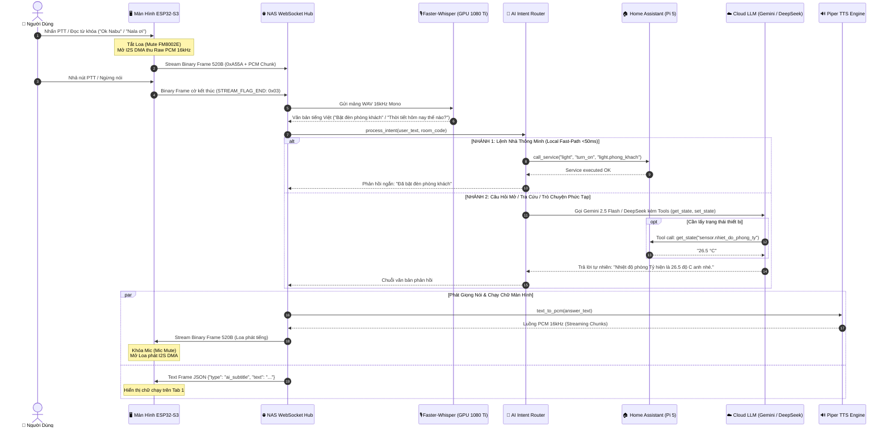

# Voice AI Pipeline, Agent Router & Model Management Implementation Plan

> **For agentic workers:** REQUIRED SUB-SKILL: Use superpowers:subagent-driven-development (recommended) or superpowers:executing-plans to implement this plan task-by-task. Steps use checkbox (`- [ ]`) syntax for tracking.

**Goal:** Xây dựng hoàn chỉnh luồng xử lý giọng nói thời gian thực (Voice-to-Action Flow), bộ định tuyến ý định 2 bước (AI Router với Local Fast-Path & Cloud Function Calling), cơ chế âm thanh Half-Duplex chống hú kèm ưu tiên Intercom, và giao diện Web Admin quản lý API Key, kiểm tra kết nối live cùng phân bổ mô hình AI/Tác nhân theo từng phòng.

**Architecture:** ESP32-S3 thu âm Raw PCM 16kHz truyền qua WebSocket Binary Frame 520 byte lên NAS Hub (GPU 1080 Ti); Engine Faster-Whisper nhận dạng giọng nói tiếng Việt; `AIRouter` phân loại mệnh lệnh (Nhánh 1: Gọi trực tiếp Home Assistant Pi 5 trong <50ms; Nhánh 2: Gọi Gemini 2.5/2.0 hoặc DeepSeek V3/R1 với Function Calling); Piper/Kokoro TTS sinh giọng nói phản hồi dạng stream nhịp nhàng kết hợp gửi Text Frame JSON chạy phụ đề trên màn hình LCD.

**Tech Stack:** Python 3.11/FastAPI, WebSockets, `google-genai`, `httpx`, Faster-Whisper, Piper TTS, LovyanGFX, LVGL 8.3.11, FreeRTOS, ESP32-S3 (Arduino framework).

**Spec:** [Master Plan (plan.md)](file:///c:/Users/phamn/Documents/PlatformIO/NALA%20SMART%20HOME/plan.md)

---

## 1. Sơ Đồ Luồng Xử Lý Giọng Nói Đến Hành Động (Voice-to-Action Flow)

---

## 2. Chi Tiết Logic Phân Luồng Tại AI Router (Cốt Lõi)

Module `AIRouter` vận hành cơ chế phân tầng 2 bước:

### Bước 1: Khớp Intent Cục Bộ (Local Fast-Path)
- Quét nhanh danh từ, động từ điều khiển tiếng Việt: `bật`, `mở`, `tắt`, `đóng`, `tăng`, `giảm`, `nhiệt độ`.
- Đối chiếu thực thể từ cache bộ nhớ `ha_bridge.states` và `ha_bridge.areas`:
  - Khớp trực tiếp `entity_id` hoặc tên thân thiện (Friendly Name).
  - Tự động gán ngữ cảnh phòng của màn hình đang phát lệnh (nếu người dùng ở *Phòng chiếu* nói "bật đèn", router tự suy diễn sang `light.den_phong_chieu`).
- Gửi lệnh trực tiếp sang Home Assistant WebSocket trong **<50ms**, hoàn toàn **không tiêu tốn token hay độ trễ LLM**.

### Bước 2: Phân Tích Cloud LLM & Function Calling
- Áp dụng khi câu hỏi vượt quá phạm vi lệnh cứng (hỏi kiến thức, thời tiết, giải thích kỹ thuật, so sánh trạng thái đa thiết bị).
- Định tuyến linh hoạt:
  - **Gemini 2.5 Flash** (Mặc định): Tốc độ phản hồi <400ms, hỗ trợ công cụ Tool Calling chuẩn xác.
  - **DeepSeek-V3 / DeepSeek-R1**: Suy luận logic tiếng Việt chuyên sâu.
  - **Local LLM (Ollama / vLLM chạy trên GPU GTX 1080 Ti của NAS 152)**: Tự động chuyển vùng dự phòng khi mất kết nối Internet.
- Bộ công cụ tích hợp sẵn cho LLM:
  - `get_entity_state(entity_id: str)`: Đọc trạng thái cảm biến, công tắc, điều hòa.
  - `set_entity_state(domain: str, service: str, entity_id: str, data: dict)`: Điều khiển thiết bị có điều kiện.
  - `get_area_overview(area_name: str)`: Lấy toàn bộ trạng thái trong một phòng cụ thể.

---

## 3. Cơ Chế An Toàn & Tối Ưu Âm Thanh (Half-Duplex Logic & Intercom Priority)

1. **Chống hú rít phần cứng (Acoustic Feedback Prevention)**:
   - Microphone và Loa đặt cách nhau <2cm trên bo mạch ES3C28P.
   - Khi ở trạng thái `AI_LISTENING`: Chân `PA_EN` (GPIO 1) được kéo về HIGH (MUTE mạch khuếch đại FM8002E).
   - Khi ở trạng thái `AI_SPEAKING`: FreeRTOS ngắt Task đọc DMA từ microphone, chỉ kích hoạt luồng DMA ghi ra DAC ES8311.
2. **Cơ chế ngắt ưu tiên tuyệt đối cho Đàm Thoại Nội Bộ (Intercom Priority Interruption)**:
   - Nếu màn hình đang trong phiên hội thoại AI (đang nghe hoặc đang phát loa trả lời) mà có tín hiệu cuộc gọi nội bộ (`INTERCOM_RX`) từ phòng khác hoặc từ Web Admin:
     - Màn hình lập tức dừng Task phát âm thanh AI, hủy bộ đệm đang chờ.
     - Server NAS hủy tác vụ LLM / TTS đang xử lý của session đó.
     - Chuyển mạch tức thời sang luồng đàm thoại 2 chiều liên tầng để ưu tiên tính an toàn và tiện ích gia đình.

---

## 4. Danh Sách Các Hạng Mục Triển Khai (Bite-Sized Tasks)

### Task 1: Thiết Kế API & Quản Lý Cấu Hình AI Trên NAS Hub
**Files:**
- Create: `server_nas_hub/app/ai_config_manager.py`
- Modify: `server_nas_hub/app/main_ws_server.py`
- Modify: `server_nas_hub/app/ai_agent_router.py`

**Interfaces:**
- Produces:
  - `GET /api/ai/config`: Trả về danh sách model khả dụng, model mặc định, key preview (`AIzaSy...****`), system prompt.
  - `POST /api/ai/config`: Lưu cấu hình AI persistent vào `data/ai_settings.json` và `.env`.
  - `POST /api/ai/test`: Kiểm tra kết nối trực tiếp với nhà cung cấp (Gemini / DeepSeek / Local LLM) và trả về `{ status: "success"|"error", rtt_ms: int, message: str }`.

- [ ] **Step 1**: Viết module `ai_config_manager.py` quản lý đọc/ghi cài đặt AI an toàn (che giấu API key khi trả về client).
- [ ] **Step 2**: Thêm endpoint kiểm tra live `test_gemini_connection(api_key)` và `test_deepseek_connection(api_key)` đo RTT thực tế.
- [ ] **Step 3**: Tích hợp các router REST API vào `main_ws_server.py`.

### Task 2: Giao Diện Quản Trị Cấu Hình Trợ Lý AI Trên Web Admin
**Files:**
- Modify: `server_nas_hub/app/static/index.html`

**Features:**
- Nút bấm `🤖 Cấu Hình Trợ Lý AI` trên thanh menu Header.
- Modal `🤖 CẤU HÌNH TRỢ LÝ AI & QUẢN LÝ MÔ HÌNH`:
  - Khung nhập Google Gemini API Key + Nút `🔍 Kiểm Tra Gemini Live` (Báo đèn xanh / RTT ms).
  - Khung nhập DeepSeek API Key + Nút `🔍 Kiểm Tra DeepSeek Live`.
  - Khung nhập Local LLM Endpoint (Ollama / vLLM chạy trên GPU GTX 1080 Ti của NAS 152) + Nút `🔍 Kiểm Tra Local AI`.
  - Dropdown chọn Model mặc định toàn hệ thống (*Gemini 2.5 Flash, Gemini 2.5 Pro, DeepSeek V3, DeepSeek R1, Local LLM*).
  - Khu vực tùy biến Persona & System Prompt (Nala Quản Gia, Jarvis Kỹ Thuật,...).
  - Bảng gán Mô hình / Tác nhân riêng biệt cho từng phòng.

- [ ] **Step 1**: Bổ sung giao diện Modal và CSS Glassmorphism theo chuẩn thiết kế Nala.
- [ ] **Step 2**: Viết logic Javascript fetch, populate dữ liệu và gọi API test live hiển thị thông báo tức thời.
- [ ] **Step 3**: Đồng bộ tức thời lựa chọn Model xuống từng panel qua WebSocket `config_sync`.

### Task 3: Nâng Cấp AI Router Với Function Calling & Local Fast-Path
**Files:**
- Modify: `server_nas_hub/app/ai_agent_router.py`

- [ ] **Step 1**: Hoàn thiện hàm `_match_local_intent` hỗ trợ trích xuất phòng và thiết bị trực tiếp từ từ khóa người dùng.
- [ ] **Step 2**: Khai báo bộ công cụ Function Calling cho Gemini (`get_state`, `set_state`) ánh xạ trực tiếp sang `ha_bridge`.
- [ ] **Step 3**: Tích hợp xử lý ngắt phiên AI khi có tín hiệu `INTERCOM_RX`.

### Task 4: Stream Subtitle & Đồng Bộ Âm Thanh Trên Màn Hình ESP32
**Files:**
- Modify: `firmware_esp32s3_panel/include/ui_lvgl_dashboard.h`
- Modify: `firmware_esp32s3_panel/src/main.cpp`

- [ ] **Step 1**: Thêm khung hiển thị phụ đề AI trên Tab 1 (`lbl_ai_response`).
- [ ] **Step 2**: Bắt sự kiện Text Frame `ai_subtitle` trong `on_ws_text()` và cập nhật chữ chạy mượt mà.
- [ ] **Step 3**: Rà soát khóa mutex Half-Duplex giữa thu mic và phát loa trong `audio_es8311_engine.h`.

---

## 5. Review Focus

1. **Bảo mật API Key**: Trình duyệt Web Admin tuyệt đối không bao giờ nhận được đầy đủ chuỗi API key nhạy cảm (phải được che `****`), chỉ gửi key mới khi người dùng bấm Lưu.
2. **Khả năng chịu lỗi mất mạng (Offline Resilience)**: Khi mất kết nối Internet, nếu người dùng ra lệnh điều khiển nhà thì Local Fast-Path vẫn phải hoạt động bình thường qua mạng LAN.
3. **Chống kẹt luồng Audio Buffer**: Khi phiên AI bị ngắt đột ngột bởi cuộc gọi Intercom, toàn bộ bộ đệm âm thanh TTS dở dang phải được giải phóng ngay lập tức trong RAM.
4. **Giới hạn độ dài câu thoại TTS**: System Prompt giới hạn tối đa 1-2 câu trả lời ngắn để thời gian phát loa không quá 5 giây, tránh làm phiền không gian gia đình.
5. **Thời gian đáp ứng (Latency Budget)**: Local Intent <50ms, Gemini Flash Intent <800ms từ lúc nhả PTT tới khi phát âm thanh ra loa.

