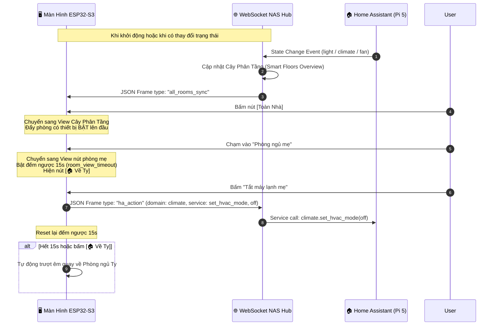

# Smart Floor & Room Hub (Cây Phân Tầng Thông Minh & Nút Toàn Nhà) Design Spec

## 1. Bối cảnh & Mục tiêu (Context & Goal)

### Bối cảnh
Màn hình cảm ứng gắn tường thông minh 2.8" (ES3C28P - ESP32-S3) hiện đang chạy firmware `v3.2.1-stable` với phần cứng (Loa ES8311, Mic ADC, Màn hình IPS, Cảm ứng điện dung) hoạt động trơn tru.
Giao diện tab Thiết Bị hiện tại chỉ hiển thị các nút bấm của một phòng duy nhất (ví dụ Phòng ngủ Ty). Khi người dùng muốn xem hoặc điều khiển các thiết bị ở phòng khác (ví dụ: tắt đèn phòng khách, kiểm tra máy lạnh phòng mẹ), họ không có cách nào quan sát trực tiếp trên màn hình nếu không có chức năng **Toàn Nhà**.

### Mục tiêu thiết kế
1. **Mặc định**: Tab Thiết Bị luôn hiển thị phòng chính của thiết bị (`home_room`, ví dụ: "Phòng ngủ ty").
2. **Nút Toàn Nhà**:
   - Khi bấm nút `[Toàn Nhà]`, màn hình hiển thị danh sách toàn bộ các phòng trong nhà được phân nhóm theo Tầng (`Tầng 2`, `Tầng 1`, `Sân vườn`).
   - **Thuật toán ưu tiên thông minh (Smart Priority Sorting)**: Tự động gom và đẩy các phòng/tầng đang có thiết bị BẬT lên đầu danh sách kèm nhãn nổi bật (`🟢 2 BẬT • ❄️ 26°C`).
   - Các phòng tắt hết được xếp gọn gàng phía dưới.
3. **Điều khiển từ xa (Remote Room View)**:
   - Khi chạm vào một phòng bất kỳ (ví dụ "Phòng ngủ mẹ"), Tab Thiết Bị lập tức chuyển sang hiển thị các nút điều khiển của phòng đó.
   - Xuất hiện nút **`[🏠 Về Ty]`** (về phòng chính) và nhãn **`Xem từ xa`**.
   - Kích hoạt **Thanh đếm ngược tự về phòng chính** (`room_view_timeout`, mặc định 15s theo cấu hình Web).
   - Nếu người dùng chạm vào bất kỳ nút điều khiển nào, timer tự reset lại 15s để không làm gián đoạn thao tác.
   - Hết thời gian đếm ngược hoặc khi bấm nút `[🏠 Về Ty]`, màn hình tự động quay về phòng chính.
4. **Bảo toàn phần cứng**: Giữ nguyên 100% tầng driver âm thanh ES8311, I2S DMA, và driver cảm ứng FT6336U đang hoạt động hoàn hảo trên bản `v3.2.1`.

---

## 2. Kiến trúc Hệ Thống & Luồng Dữ Liệu (Data Flow)



---

## 3. Cấu trúc Gói Tin Dữ Liệu WebSocket (Schema)

### 3.1. NAS Hub gửi xuống Panel: `all_rooms_sync`
```json
{
  "type": "all_rooms_sync",
  "home_room": "Phòng ngủ ty",
  "room_view_timeout": 15,
  "floors": [
    {
      "floor_id": "tang2",
      "floor_name": "TẦNG 2",
      "active_count": 2,
      "rooms": [
        {
          "name": "Phòng ngủ ty",
          "is_home": true,
          "active_count": 2,
          "buttons": [
            { "id": "ty_ac", "name": "Máy lạnh ty", "domain": "climate", "icon": "climate", "is_on": true, "sub": "Cool 25°C" },
            { "id": "ty_l1", "name": "Đèn trần", "domain": "light", "icon": "light", "is_on": true, "sub": "Đang bật" },
            { "id": "ty_l2", "name": "Đèn ngủ (2)", "domain": "light", "icon": "light", "is_on": false, "sub": "Đã tắt" }
          ]
        },
        {
          "name": "Phòng ngủ mẹ",
          "is_home": false,
          "active_count": 1,
          "buttons": [
            { "id": "me_ac", "name": "Máy lạnh mẹ", "domain": "climate", "icon": "climate", "is_on": true, "sub": "Cool 26°C" },
            { "id": "me_l1", "name": "Đèn ngủ mẹ", "domain": "light", "icon": "light", "is_on": false, "sub": "Đã tắt" },
            { "id": "me_l2", "name": "Đèn trần", "domain": "light", "icon": "light", "is_on": false, "sub": "Đã tắt" }
          ]
        }
      ]
    }
  ]
}
```

### 3.2. Panel gửi lệnh điều khiển lên NAS Hub: `ha_action`
```json
{
  "type": "ha_action",
  "source": "44:1B:F6:CF:88:1C",
  "payload": {
    "domain": "light",
    "service": "toggle",
    "entity_id": "light.cong_tat_phong_ngu_me_den_1"
  }
}
```

---

## 4. Thiết Kế Giao Diện Màn Hình (LVGL 240x320)

### 4.1. Header Bar (38px)
- Bên trái: Icon phòng + Tên phòng (`Phòng ngủ ty` hoặc `Phòng ngủ mẹ`).
- Giữa/Phụ: Badge `Xem từ xa` màu cam (khi xem phòng khác).
- Bên phải:
  - Nút **`[🏠 Về Ty]`**: Chỉ hiện khi đang xem phòng khác.
  - Nút **`[🌐 Toàn Nhà]`**: Luôn có mặt để chuyển đổi giữa danh sách cây phân tầng và lưới nút thiết bị.

### 4.2. Dải đếm ngược (Countdown Strip - 18px)
- Chỉ hiển thị khi đang xem phòng khác và `room_view_timeout > 0`.
- Hiển thị văn bản: `⏳ Tự về phòng chính: 15s`.
- Mỗi giây giảm 1s. Khi có touch event trên màn hình, reset về 15s.

### 4.3. Body: Lưới nút thiết bị (Grid 2 cột)
- Hiển thị các nút bấm của phòng đang chọn (5, 6 hay 8 nút đều hỗ trợ cuộn dọc mượt mà bằng LVGL `LV_SCROLL_DIR_VER`).
- Card Máy lạnh: Hiển thị icon tuyết ❄️, trạng thái Cool/Dry/Off, nhiệt độ cài đặt.
- Card Đèn: Hiển thị icon bóng đèn 💡, LED chỉ thị trạng thái on/off.

---

## 5. Chiến Lược Triển Khai Theo Từng Giai Đoạn (Phased Plan)

- **Giai đoạn 1 (Server & Web Hub)**:
  - Cập nhật backend `server_nas_hub/app/main_ws_server.py` để đóng gói và đồng bộ bản tin `all_rooms_sync` chuẩn cấu trúc JSON.
  - Cập nhật Web Admin Dashboard `server_nas_hub/app/static/index.html` để quản lý thông số `room_view_timeout` cho từng panel.
- **Giai đoạn 2 (Firmware ESP32-S3 Panel)**:
  - Cập nhật `ui_lvgl_dashboard.h` và `main.cpp`:
    + Thêm state `is_viewing_remote_room` và timer `room_timeout_ms`.
    + Triển khai logic render cây phân tầng và sắp xếp phòng có thiết bị bật lên đầu.
    + Thêm nút `[Toàn Nhà]` và `[🏠 Về Ty]` trên header.
  - Biên dịch và phát hành bản nâng cấp `v3.3.0` qua OTA NAS Hub.
- **Giai đoạn 3 (Nghiệm thu thực tế)**:
  - Thao tác thực tế trên màn hình thật tại COM20 hoặc qua WiFi.
  - Kiểm tra đếm ngược tự về phòng chính, kiểm tra điều khiển chéo phòng.
